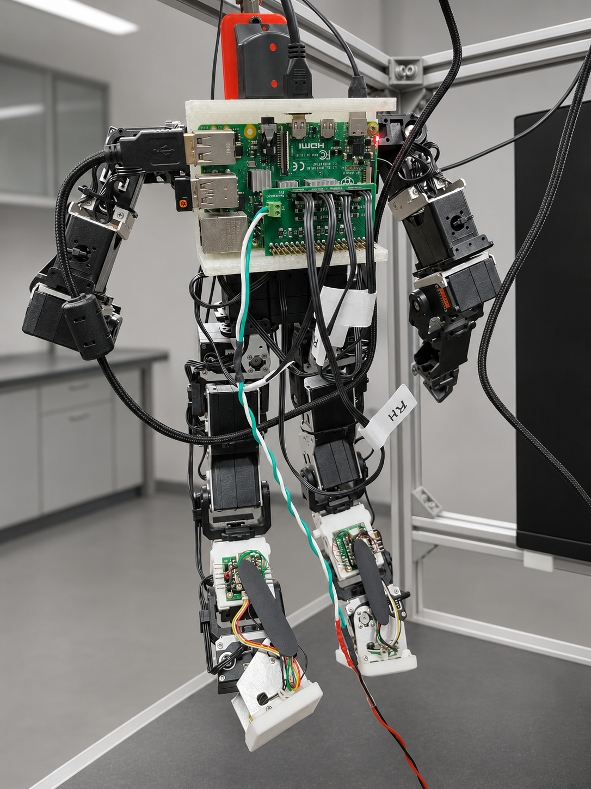
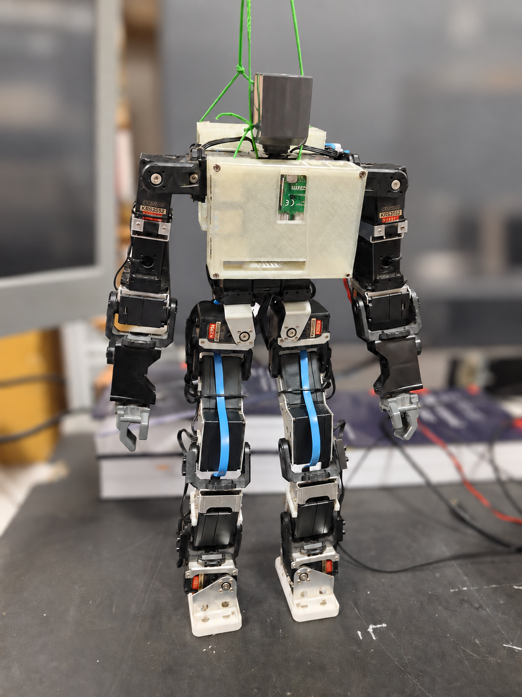

# Kondo_KRS_RPi
A Linux library for Raspberry Pi to operate the KRS motors (Kondo humanoid) using GPIO UART ports. 

Software dependencies: [wiringPi]([url](https://github.com/WiringPi/WiringPi)). wiringPi is needed for toggling RX/TX/En using the tri-state buffer.

Hardware dependencies: PCB for half-duplex communication with Kondo KRS 2552 motors.  The PCB designed is open-sourced here. However there are major changes in the PCB. A new version that is physically tested will be uploaded soon.

  
  

